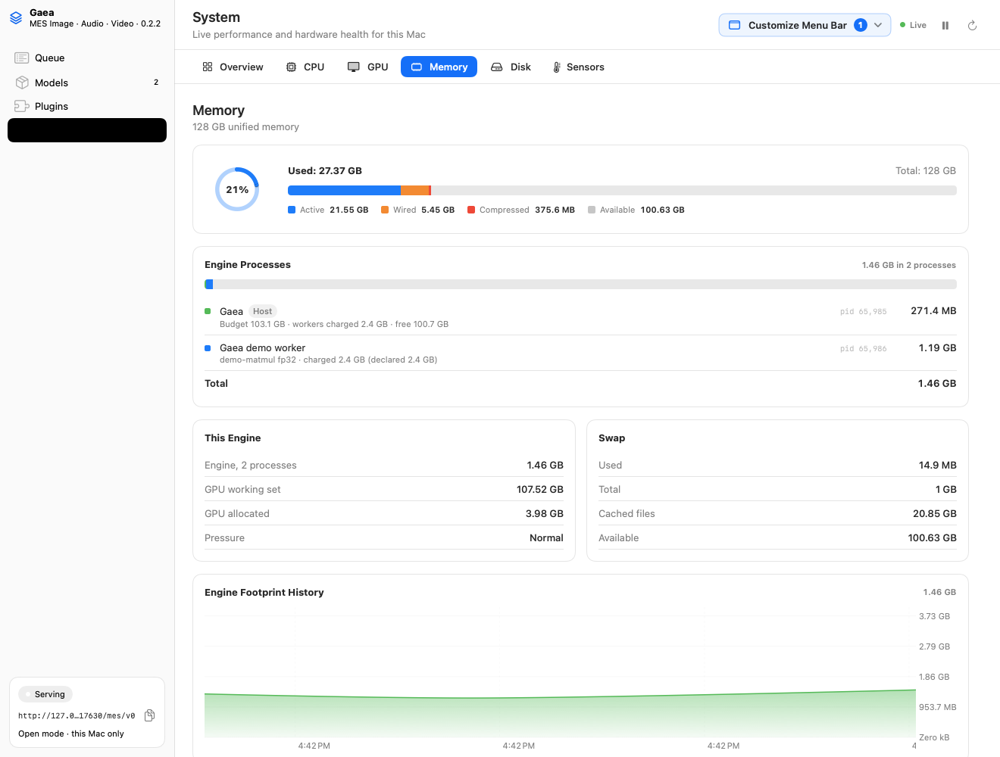

# AB-T-0371: the cross-process governor (in progress)

| | |
|---|---|
| **State** | The System page part is done (Gaea 0.2.2, below). Admission and eviction wait on the shared policy, AB-T-0357 (mlx-engine-swift v0.73.0, contract 1.58.0), which is not out yet |
| **Machine** | Mac17,14 (Apple M5 Max, 128 GB), macOS 27.2 |

## The System page shows the ledger

The System page already listed Gaea and each worker with its measured `phys_footprint`, and summed them (AB-T-0355).
Now each line also carries the ledger (MEM-4):
- **Under Gaea:** the budget, what the workers are charged, and what is free, plus any queued jobs.
- **Under each worker:** its models' lanes, and its charge: the larger of what it declared and what it measures, with
  the declaration beside it. It also says when the worker is running a job, or has run past its declaration.

[Dark](console-system-memory-dark.png). The worker is the demo's, after a snapshot run of `demo-matmul`: charged 2.4 GB
as declared, measured 1.19 GB.

MESKit's Engine Processes card has no budget of its own, so the budget is text on Gaea's line. A bar for it would be a
MESKit change, through mlx-apps.

## Fixed along the way

`Gaea --snapshot` rendered every page and then never quit. It called `NSApp.terminate` from inside a main-actor task.
The app answered `terminateLater` and scheduled the workers' shutdown on another main-actor task, which can't start
until the first one returns. The snapshot now stops the workers itself and exits. It finishes in 9.7 s and leaves no
worker running. The bug was there since Gaea 0.1.0.

## Still to do (after AB-T-0357)

- **Admission and eviction from the shared policy.** One rule, used by both Gaea and MLXEngine. It must charge idle
  workers their resident bytes, not their peak (the AB-T-0363 finding).
- **A recorded run under a budget smaller than the models' sum.** Qwen-Image-Edit, Z-Image and the forge pack, with
  no OOM, evictions logged with the policy's reason, and transcripts that validate.
- **A receipt** of the ledger against the footprints the host reads itself.
