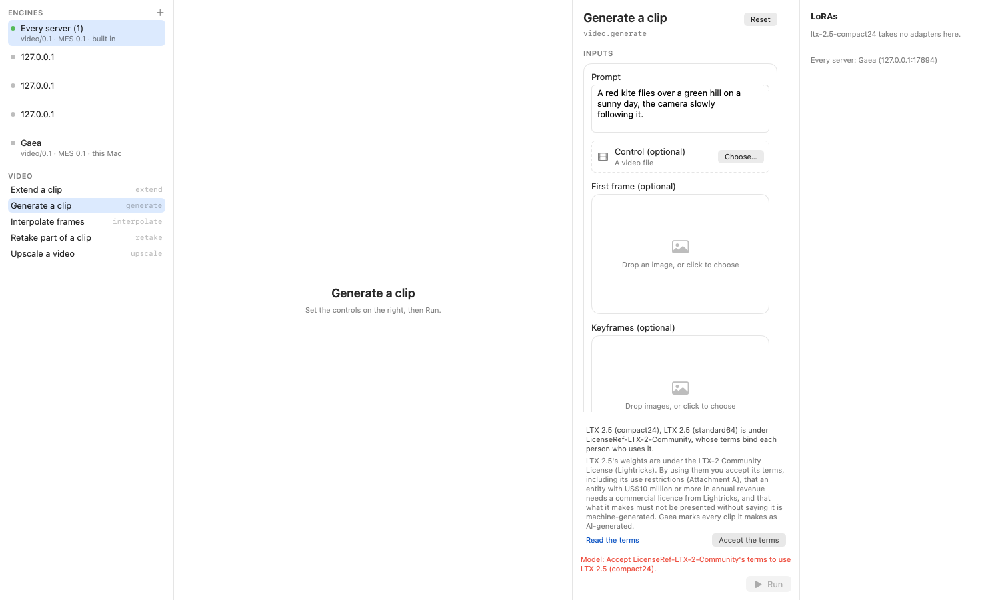
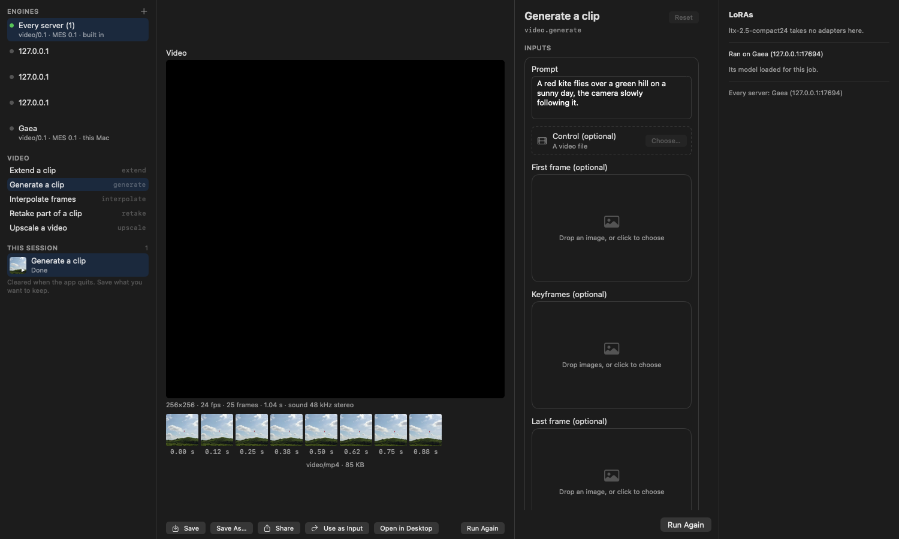

# AB-T-0406: Gaea Lab on video

| | |
|---|---|
| **Date** | 2026-11-01 |
| **Gaea** | 0.11.3, on media-engine-spec v0.9.0 (Video 0.1) |
| **Gaea Lab** | on [pixel-agency-run v0.3.0](https://github.com/xocialize/pixel-agency-run/releases/tag/v0.3.0) (19f5ef3, AB-A-0243, receipt AB-R-0698) and media-engine-spec 0.9.0 |
| **Plugins** | gaea-plugin-ltx 0.1.1, gaea-plugin-seedvr2 0.1.0 and gaea-plugin-rife 0.1.0, installed from GitHub |
| **Machine** | Mac17,14 (Apple M5 Max, 128 GB), macOS 27.2 |
| **Large files** | every clip, report and session are on `/Volumes/DEV_VOL1/Evidence/gaea/AB-T-0406` |

## What it took

**pixel-agency-run v0.3.0** (mlx-apps, AB-A-0243) adds video to the run workflow:
- video inputs and results, with their facts, used as the next run's input;
- generate's keyframes with `keyframe_times`;
- previews collected as frames;
- users' acceptance: the terms shown before a run, `policy.accepted` sent, and a 422 `policy_unmet` shown as needing
  acceptance.

Its views come from MESFormsUI 0.9.0: VideoInputWell, VideoPlayerView, FramePreviewStrip and LicenseAcceptanceView.

**Gaea Lab** moves to it:
- **`lab-run`** gains `--accept <spdx>` and `--previews`. It reads a clip's facts when it's given as `--file`, and
  prints a video result's facts, the warnings, and which `--accept` a refusal needs. Its acceptances are kept to the
  one run.
- **The app** gives the workflow the user's acceptances (kept in their defaults). `--snapshot` keeps its own, and gains
  a `video.generate` preset on LTX compact24.

**Gaea 0.11.3: disclosure names the model that edits.** An extend or retake's comment must name its model (Video
§1.9). Gaea kept any source comment that already said `AI-generated`, so a clip standard64 made and compact24 extended
named only standard64. It now adds the disclosure unless the source's comment already names this model.

## Result

**Pass, 28 of 28** ([lab-video.log](lab-video.log), `tools/lab-video.sh`). Every job went through `lab-run`'s
RunSession over EnginePool, with each clip the next one's input:

| Step | Model | Out (w×h, frames, fps, sound) | Comment |
|---|---|---|---|
| generate, no `--accept` | compact24 | refused 422 `policy_unmet`, `terms_not_accepted`; "add --accept LicenseRef-LTX-2-Community" | — |
| generate from a first frame, 1 s | compact24 | 256×256, 25, 24, yes (`duration_snapped`) | AI-generated by LTX 2.5 (compact24) |
| generate, `quality: standard`, first frame and a keyframe at 0.5 s | standard64 | 256×256, 25, 24, yes | AI-generated by LTX 2.5 (standard64) |
| extend the standard64 clip by 1/3 s | compact24 | 256×256, 33, 24, yes | AI-generated by LTX 2.5 (standard64) — AI-generated in part by LTX 2.5 (compact24) |
| extend the first clip by 1/3 s | compact24 | 256×256, 33, 24, yes | AI-generated by LTX 2.5 (compact24) |
| retake 0.4–0.7 s of that (`span_snapped` to 0.375–0.708 s) | compact24 | 256×256, 33, 24, yes | kept |
| upscale ×2, `live_action` | seedvr2-int8 | 512×512, 33, 24, yes | kept |
| interpolate ×2 | rife-4.25 | 512×512, 65, exactly 48, yes | kept |

The four worker sessions (LTX twice, SeedVR2, RIFE) validate against GPP-1.

**The app** (`GaeaLabApp --snapshot`, on Every server):

| Before: LTX's terms, Run disabled | After: the clip, its facts and frames |
|---|---|
|  |  |

- **Before the run,** the Lab shows the licence's terms, notice and Accept, says which terms the model needs, and
  keeps Run disabled.
- **Accepted for that run only,** the generate finished on Gaea. It shows the clip's facts
  (`256×256 · 24 fps · 25 frames · 1.04 s · sound 48 kHz stereo`), eight frame thumbnails, and the session row with a
  video thumbnail.
- **The user's defaults** hold no acceptance afterwards.

[before, dark](lab-video.generate-before-dark.png) · [after, light](lab-video.generate-after-light.png)

## Not covered

- **The player's picture.** An off-screen capture doesn't draw AVKit's video layer, so the player is black in the
  snapshots. The frames under it are decoded from the same file.
- **Previews from Gaea.** No video plugin sends `job.preview` yet (VIDEO-014 skips). pixel-agency-run's previews are
  tested against MockVideoEngine only.
- **Use as Input through the UI.** lab-run passes each saved clip as the next `--file`. pixel-agency-run's tests run
  the workflow's own use-as-input (generate, then extend, then upscale) against the mock.
- **A soundtrack, a last frame, and LTX's larger sizes** through the Lab. They pass through Gaea in AB-T-0404 and
  AB-T-0405.
