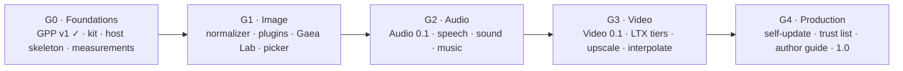

# Gaea: product requirements

| | |
|---|---|
| **Status** | Draft 0.2, 2026-10-28: the three open questions are decided (G-21 to G-23). Replaces [Engines-PRD](../../ml%28x%29/PixelAgency/Docs/Engines-PRD.md) (superseded 2026-10-27). |
| **Product** | **Gaea**: one MES media server for the Image, Audio and Video profiles, whose models are plugins. Plus **Gaea Lab**, its reference client. |
| **Licence** | Apache-2.0 for Gaea, GaeaPluginKit and our plugins (G-21), on GitHub ([xocialize-code/gaea](https://github.com/xocialize-code/gaea)). Model weights download separately under their own licences. |
| **Platform** | Apple silicon, macOS 26 or later (mlx-engine-swift 0.72.0 requires it). |
| **Companion documents** | [Concept](Gaea%20-%20Generative%20multimedia%20server.md) · [Plan](Gaea%20-%20Plan.md) (decisions G-1 to G-20, architecture, phases) · [GPP-1](../spec/GPP-1.md) (the plugin protocol and manifest) · [MES-PRD](../../ml%28x%29/PixelAgency/Docs/MES-PRD.md) · [Desktop-PRD](../../ml%28x%29/PixelAgency/Docs/Desktop-PRD.md) |

> **Sources:** **N** the operator's concept or direction · **A** adopted from the plan's decisions or the Engines PRD ·
> **P** proposed here. `G-n` is a plan decision (AB-D-0163 to AB-D-0185), `ENG-n`/`IMG-n`/`VID-n` an Engines-PRD
> requirement carried over, and `MES:` the MES PRD.

---

## 1. Summary

Gaea is the production form of what the Pixel Agency engines started. It is **one open-source MES server** that serves
any compliant client (Pixel Agency Desktop, Gaea Lab, the `mes` CLI, third-party apps, MCP agents) with image, audio
and video generation and processing on the Mac.

- **Gaea does five jobs:** the MES front end, the queue, memory across processes, the plugin lifecycle and the UI.
- **Plugins do the generating.** A plugin is a signed `.gaeaplugin` executable bundle that runs one model family (or
  a pack of small models) in a process of its own. Gaea installs plugins from GitHub by repo URL, keeps them up to
  date, and drives them over the Gaea Plugin Protocol (GPP).
- **Clients speak MES only.** Model-specific options and LoRA adapters travel through MES's own channels (`x-`
  extensions, adapters), and Gaea hands them to the plugin unchanged.
- **Image first, then audio, then video** (N).

## 2. Users

| Persona | Uses Gaea to | Src |
|---|---|---|
| **App users** (Desktop, Gaea Lab) | Run AI operations from an app, on this Mac or a server on the LAN | N |
| **Agent users** | Call `image.*`, `audio.*` and `video.*` as MCP tools | A |
| **Developers** | Script Gaea over REST or the `mes` CLI; build apps on MESClientKit | N |
| **Operators** | Run Gaea on a Mac: add, update, enable and disable plugins; watch memory and the queue | N |
| **Studios** | Run several Gaea servers on the LAN, each focused on an area, shared by everyone's clients | N |
| **Plugin authors** | Bring a model to Gaea by publishing a plugin repo; it appears in every client with no client change | N |

## 3. Goals and non-goals

**Goals:**
- G1. **Full coverage** of the MES Image, Audio and Video profiles, passing each conformance suite. (A)
- G2. **Every model we can offer, normalized** behind operations and quality tiers (MES:NORM). (A)
- G3. **Models without Gaea releases:** a new model or a model update ships as a plugin release. (N)
- G4. **Memory that never surprises:** Gaea knows each model's footprint before loading it and can always get memory
  back. (N)
- G5. **Stateless and safe to restart:** no media outlives its job (MES:SPEC-9). (A)
- G6. **Honest results:** licence, effective parameters and provenance in every result. (A)

**Non-goals:**
- Libraries, projects or asset management: clients' job.
- Remote providers (hosted APIs). Apps that want one implement it themselves (G-12).
- Configuring a server from a client. Clients never configure Gaea; it is configured in its own UI (G-17).
- Forwarding jobs between servers. Clients choose a server for each job (G-19).
- Plugin UI code. Plugins describe their options; Gaea renders them.
- The Mac App Store, and sandboxing (G-6).
- Platforms other than Apple silicon. The spec itself stays platform-neutral.

## 4. Server (SRV)

| ID | Requirement | Src | Notes |
|---|---|---|---|
| SRV-1 | **MES Base, unchanged:** REST, WebSocket, SSE and MCP bindings, the job lifecycle, the spool and retention, pairing, Bonjour discovery. | A | MESEngineKit; G-3 |
| SRV-2 | **One server per Mac serves every profile,** so one scheduler sees all the memory. | A | G-1; replaces Engines OQ-2 |
| SRV-3 | **Profile normalizers** validate requests against the profile, choose a model offer (named, or by tier and content), and assemble `effective`, provenance, licences and warnings. | A | Plan §2.1, §3.3 |
| SRV-4 | **Model-specific options pass through unchanged:** `model_params` (only `x-` keys) and `adapters` reach the plugin as the client sent them. | N | G-3; concept: "a json or similar dictionary … passed to the plugin" |
| SRV-5 | **Helper sequencing:** Gaea runs multi-step plans itself, such as a prompt rewrite by the LLM plugin before a generate. | A | G-10; plan §3.3 |
| SRV-6 | **The spool is private and swept:** per-job folders, deleted on completion or TTL, and swept at launch after a crash. | A | ENG-7 |
| SRV-7 | **Pairing by default; open mode on loopback** for development and for clients on the same Mac. | A | ENG-8 |
| SRV-8 | **Crash-safe:** if a worker dies, its job fails or is requeued once and the client is told; if Gaea dies, in-flight jobs fail on reconnect. Client media is never lost, because the client holds it. | A | ENG-10 |
| SRV-9 | **Several servers on a LAN,** each advertising only the operations and models its enabled plugins offer. Servers don't coordinate. | N | G-19 |
| SRV-10 | **Headless or menu bar.** The server runs without its UI, for example at login on a studio Mac. | P | ENG-9 |

## 5. Scheduler and memory (MEM)

| ID | Requirement | Src | Notes |
|---|---|---|---|
| MEM-1 | **One GPU job at a time across Gaea** in v1. Small jobs may run alongside a heavy one only once that has been measured. | N | G-13 |
| MEM-2 | **A fair queue:** affinity to the resident model, aging so nothing starves, cancellation that reaches the model, keep-warm, pin. | A | ENG-3 |
| MEM-3 | **Admission from the manifest:** Gaea knows each lane's persistent and peak transient bytes before it launches anything, and admits a job only when it fits. | A | G-8; `ResolvedLane` (AB-A-0206) |
| MEM-4 | **A ledger across processes:** each worker's declared charge and its measured `phys_footprint`, summed against the Mac's budget. A worker that runs past its declaration is logged against the plugin version. | A | G-8; GPP-1 §3.2 |
| MEM-5 | **Memory comes back on demand:** unload, then shutdown, then SIGTERM, then SIGKILL, each with a bounded wait. | A | GPP-1 §5; the spike freed 5.12 GB in 65 ms |
| MEM-6 | **Each worker gets a budget** and sizes MLX's cache and wired limits from it. | A | `WorkerBudget` (AB-A-0206) |
| MEM-7 | **Lane choice by memory:** where a model has several lanes (quants), Gaea loads the operator's default lane when it fits, else the largest smaller lane that fits, and adds a `lane_fallback` warning naming both. A request that names a lane (`x-gaea.lane`) gets that lane or is refused; it never falls back. | N | G-23; manifest `lanes[]` |
| MEM-8 | **One shared weights folder,** `~/Library/Application Support/MLXEngine/Models`, shared with the ML[X] apps and Desktop. | A | G-9; ENG-13 |
| MEM-9 | **Download without loading,** on the operator's command, with progress and a size preview. | A | GPP `materialize`; AB-A-0206 |

## 6. Plugins (PLG)

| ID | Requirement | Src | Notes |
|---|---|---|---|
| PLG-1 | **A plugin is a signed executable bundle** (`.gaeaplugin`): a worker binary, its metallib and resources, and a sealed `manifest.json`. It runs as a child process. | A | G-2; GPP-1 §4 |
| PLG-2 | **Added by Git repo URL** in Gaea's UI. Gaea reads the repo's GitHub Releases for the plugin and its updates. | N | G-18; concept |
| PLG-3 | **Trust from the signature, never the URL:** Gaea runs only plugins signed by a trusted team. The check runs at install and again at launch. **In v1 the only trusted team is ours;** another team's release is refused with a message saying third-party plugins come later. The trust list and its approval flow ship in G4. | N | G-7, G-18, G-22 |
| PLG-4 | **Update and roll back:** versions installed side by side, switched when idle, the previous one kept. Gaea checks for updates and shows what changed. | N | Concept: "check for newer versions" |
| PLG-5 | **Enable and disable** a plugin, or any model in it. A disabled model disappears from descriptors. | N | G-18 |
| PLG-6 | **Plugins describe; Gaea renders.** Each plugin's settings and model options are forms that Gaea draws from the manifest (MESFormsUI). Plugins ship no UI code. | A | Plan §2.1; replaces the concept's "UI per model" |
| PLG-7 | **A plugin's data lives in Gaea's database** through GPP storage requests: namespaced, versioned, migrated by Gaea. No plugin opens the database. | N | G-5, G-16; concept |
| PLG-8 | **The manifest is generated from code** at build time and validated before signing, so it can't drift. | A | GPP-1 §4; AB-T-0353 |
| PLG-9 | **Granularity:** one plugin per heavy model family, one processing pack for small models, one LLM plugin for prompt enhancement. | A | G-10 |
| PLG-10 | **GaeaPluginKit and a template repo** make a plugin mostly declaration: the author writes the model-specific mapping; the kit does the protocol, the manifest and releases. | A | G-11; AB-T-0354 |
| PLG-11 | **Licences before downloads:** each model's licence is shown, and a research or non-commercial model is opt-in and accepted before its weights download. | A | ENG-6, ENG-14 (without the App Store channel) |

## 7. Operator UI (UI)

| ID | Requirement | Src | Notes |
|---|---|---|---|
| UI-1 | **A menu bar app:** start and stop the server, the running job, memory at a glance, open the console. | N | Concept |
| UI-2 | **The console:** Queue, Models, Plugins and System pages. | N | MESEngineUI, MESKit v0.5.0 (AB-A-0207) |
| UI-3 | **Plugins page:** add by repo URL, update, roll back, enable and disable, approve a new team. | N | G-18 |
| UI-4 | **System page:** memory per worker and in total, against the Mac's capability (chip, memory, disk speed). | N | Concept: "salvaged from the image engine" |
| UI-5 | **All configuration happens on the server,** in this UI. A local operator API serves the console, and a `gaea` CLI on the same Mac covers status and logs. Nothing is configurable remotely. | N | G-17 |
| UI-6 | **Logs per plugin:** each worker's stderr, kept and viewable in the console and with `gaea plugins logs`. | P | Plan §6 |

## 8. Image profile (IMG)

| ID | Requirement | Src | Notes |
|---|---|---|---|
| IMG-1 | **Every Image profile operation** (MES §8.3). | A | Engines IMG-1 |
| IMG-2 | **Generation and edit plugins:** Z-Image (Turbo), FLUX.2 Klein, Qwen-Image-Edit. Research models (SenseNova, Mage-Flow, Qwen-Image 2.1, FLUX 3 Klein, MOSS-Image) are opt-in and named-only. | A | Plan G1; Engines IMG-2 |
| IMG-3 | **The processing pack:** fill and erase (LaMa, MI-GAN), upscale (NERVE, RealPLKSR, HEART), matte (BiRefNet), segment (SAM 2.1, EdgeTAM), and the restore models. | A | Plan G1; Engines IMG-3, IMG-4 |
| IMG-4 | **Composite operations:** `image.extend` as inpainting on a padded canvas, `image.erase` as prompt-less inpainting, large upscales tiled. | A | Engines IMG-5 |
| IMG-5 | **Prompt enhancement** through the LLM plugin, as a helper Gaea calls before a generate. | A | G-10 |
| IMG-6 | **The measured tier plan carries over** from the Image Engine (D-33), and parity with it is G1's exit test. | A | Engines §5; TierBench |

**How the image normalizer plans each operation,** as measured for the Image Engine (D-33). A row changes only with a
new measurement:

| Operation | Draft | Standard | Best |
|---|---|---|---|
| `image.generate` | Klein 4B (4 steps) | Z-Image Turbo (8 steps) | Z-Image Turbo |
| `image.edit`, and fill or extend with a prompt | Klein 4B | Klein 4B | Klein 4B (provisional) |
| `image.fill`, `image.erase`, `image.extend` (no prompt) | MI-GAN | LaMa | LaMa |
| `image.upscale` (photo) | NERVE | RealPLKSR | HEART |
| `image.segment` | EdgeTAM (by name) | SAM 2.1 | SAM 2.1 |
| `image.matte` | BiRefNet | BiRefNet | BiRefNet |

## 9. Audio profile (AUD)

Audio needs MES Audio 0.1 first, which in turn needs RFCs 0001 to 0003 accepted (plan §4). The operation set below is
the one in media-engine-spec's `docs/AUDIO-EVALUATION.md`.

| ID | Requirement | Src | Notes |
|---|---|---|---|
| AUD-1 | **Every Audio profile operation** once Audio 0.1 is published: `audio.speak`, `audio.design_voice`, `audio.edit_speech`, `audio.generate`, `audio.compose`. | N | |
| AUD-2 | **Speech:** Kokoro, VoxCPM2, MOSS-TTS and Qwen3-TTS speak; Qwen3-TTS and VoxCPM2 design voices from a description. | A | Plan G2 |
| AUD-3 | **Speech editing:** Step-Audio-EditX; AuK named-only. | A | Plan G2; AB-A-0188 |
| AUD-4 | **Sound effects:** MOSS-SoundEffect. | A | Plan G2 |
| AUD-5 | **Music:** ACE-Step 1.5 by default, with MiniMax Music 3 and YuE2 as further offers under their own licence postures. | A | Plan G2; AB-A-0201, AB-A-0202 |
| AUD-6 | **Streamed output** (RFC 0002) end to end: a plugin's GPP `chunk` lines become MES stream events. | A | GPP-1 §3.3 |

## 10. Video profile (VID)

Video needs Base time conventions and MES Video 0.1 first (plan §4). Everything runs locally (G-12).

| ID | Requirement | Src | Notes |
|---|---|---|---|
| VID-1 | **Every Video profile operation:** `video.generate`, `video.extend`, `video.retake`, `video.upscale`, `video.interpolate`. | A | Engines VID-1 |
| VID-2 | **LTX 2.5:** text- and image-to-video with 48 kHz audio, audio-to-video, first and last frame plus keyframes, retake and extend, LoRA and IC-LoRA as adapters. | A | Engines VID-2 |
| VID-3 | **LTX tiers as lanes,** compact24 to max128, chosen by memory; weight streaming with disk-speed floors. Every tier stays within its budget on 32, 64 and 128 GB Macs. | A | Engines VID-3; plan G3 |
| VID-4 | **Upscaling:** SeedVR2 and FlashVSR, with `content` required and a refused tier never swapped. | A | Engines VID-5 |
| VID-5 | **Interpolation:** RIFE. | A | Engines VID-6 |
| VID-6 | **The LTX licence ships with the plugin,** is shown when LTX is first enabled, and outputs keep their AI-content disclosure. | A | Engines VID-8, D-17 |

## 11. Clients (CLI)

| ID | Requirement | Src | Notes |
|---|---|---|---|
| CLI-1 | **MESClientKit is the SPM apps use** to talk to Gaea, or to any MES engine. | N | Concept: "SPMs that provide a way for our other applications to communicate with Gaea" |
| CLI-2 | **An engine picker** sends each job to a paired server that offers the operation and model, preferring one with the model resident and a short queue; an app can pin a server. | N | G-19; MESKit v0.5.0 `EnginePicker` |
| CLI-3 | **Gaea Lab** is the reference client: the App → SPM → Gaea → model → LoRA pipeline end to end, growing with each profile. It is the client the MES client conformance suite runs against. | N | G-14; concept |
| CLI-4 | **Pixel Agency Desktop works without Gaea.** Its built-in engine keeps light processing; only scaling goes to Gaea. It finds a Gaea server on the LAN or points to Gaea's releases. | A | G-20 |

## 12. Distribution (DST)

| ID | Requirement | Src | Notes |
|---|---|---|---|
| DST-1 | **Developer ID, hardened runtime, notarized in CI** for Gaea and every plugin. No sandbox, no App Store. | N | G-6 |
| DST-2 | **GitHub releases** for Gaea (`xocialize-code/gaea`) and for each plugin repo. | N | G-11 |
| DST-3 | **Gaea updates itself** through the same GitHub release path (or Sparkle). | P | Plan G4 |
| DST-4 | **A guide for plugin authors,** built on the template repo, shipping with the trust list. | P | Plan G4; G-22 |
| DST-5 | **Apache-2.0** for Gaea, GaeaPluginKit and every plugin we publish. A manifest's `license` names the plugin's code licence; each model's weight licence is separate. | N | G-21 |

## 13. What we reuse

| Existing asset | Used for | Change needed |
|---|---|---|
| MESKit 0.5.0 (MESEngineKit, MESEngineUI, MESFormsUI, MESClientKit) | Front end, console, forms, clients, picker | Gaea implements the Plugins backend and a database-backed enablement store |
| mlx-engine-swift 0.72.0 | Inside every worker; MLXToolKit in the host to read manifests | Item 6 (governor policy without MLX) is AB-T-0357 |
| pixel-agency-image-engine | The image normalizer and tier plan | Host half becomes an MLX-free library shared with Desktop (G-20, AB-T-0359) |
| mlx-image-runtime | Model catalog → plugin `offers[]` | Split into plugins; `ImageServerAPI` and `ImageServerModels` stay a library |
| ForgeCore, ForgeOptimizerKit | The processing pack | Packaged as a plugin |
| prompt-enhance-kit, mlx-qwen-llm-swift | The LLM plugin | Packaged as a plugin |
| Model packages (z-image-swift, …, ltx-2-mlx-swift) | One plugin repo per family | None to the packages |
| The plugin-exec spike | Installer, signature checks, process driver | Grown into the host |

## 14. Risks

The plan's §6 holds the full list. The product-level ones:

| # | Risk | Why it matters | Mitigation |
|---|---|---|---|
| R1 | **Fixed cost per process** (MLX start-up, Metal context) | Small models pay it on every cold start | Measure in G0 (AB-T-0356); keep workers warm; group small models in packs |
| R2 | **One GPU job at a time** (MEM-1) | Throughput on a busy server | Measure before relaxing it; spread work across servers (SRV-9) |
| R3 | **A repo URL pointing at someone else's code** | Running untrusted code | The signature decides (PLG-3) |
| R4 | **Spec work gates audio and video** | G2 and G3 can't exit without published profiles | Spec work runs during the phase before |
| R5 | **Research and non-commercial models** | Users mistake them for usable ones | Opt-in, named-only, licence shown and accepted (PLG-11) |
| R6 | **macOS 26 floor** | Older Macs can't run Gaea | Accepted: the engine requires it |

## 15. Open questions

None open. Answered on 2026-10-28:

| # | Question | Answer | Decision |
|---|---|---|---|
| OQ-1 | **Gaea's licence.** The engines were Apache-2.0 (D-2). | Apache-2.0 for Gaea, GaeaPluginKit and our plugins; each model keeps its own weight licence. | G-21 (AB-D-0183) |
| OQ-2 | **Plugins from other teams in v1,** or ours only until G4's trust list? | Ours only in v1; the trust list ships in G4. | G-22 (AB-D-0184) |
| OQ-3 | **Lane fallback (MEM-7):** load a smaller lane automatically, or refuse and tell the client? | Fall back and warn in the result; a request that names a lane never falls back. | G-23 (AB-D-0185) |

## 16. Phasing

The plan's §5 has each phase's work and exit tests.

## Appendix. Revision history

- **0.2 (2026-10-28):** the open questions are decided: Apache-2.0 (G-21, new DST-5), our plugins only in v1 (G-22,
  PLG-3), and lane fallback with a warning (G-23, MEM-7).
- **0.1 (2026-10-28):** first draft. Carries over the Engines PRD's surviving requirements (ENG-3, 6, 7, 8, 10, 13, 14;
  IMG-1 to IMG-5; VID-1 to VID-3, VID-5, VID-6, VID-8) and the measured image tier plan. Drops what Gaea decided
  against: sandboxing and the App Store (ENG-11, ENG-12, G-6), remote providers (VID-4, G-12), one engine per profile
  (G-1). Adds the plugin, memory and operator requirements from the plan, G-1 to G-20.
