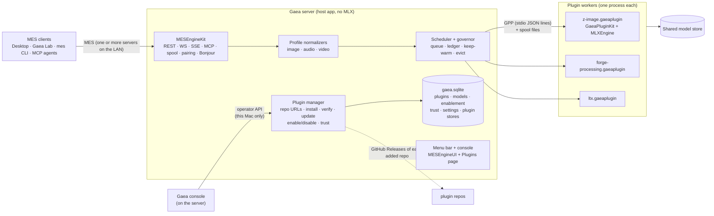

# Gaea: plan

| | |
|---|---|
| **Status** | Draft 0.9, 2026-10-28: decisions filed on the bridge (AB-D-0163…0185). **G0's exit tests pass** (AB-T-0353…0356 done; Gaea v0.1.1). **G1's work orders are filed** (AB-T-0363…0375). Asks answered: mlx-engine-swift v0.72.0 (AB-A-0206), MESKit v0.5.0 (AB-A-0207). AB-A-0208 added G-20 and its follow-ups (AB-T-0358…0362) |
| **Source** | [Gaea - Generative multimedia server](Gaea%20-%20Generative%20multimedia%20server.md) (the concept; "Quanos" was the working name before Gaea) |
| **Evidence** | [Plugin spike](../Spikes/plugin-exec/README.md): downloaded, signed executable plugins run real MLX jobs on the GPU (13 of 13 checks passed) |
| **Replaces** | The separate Pixel Agency Image Engine and Video Engine in `ml(x)/PixelAgency/Docs/Engines-PRD.md` |
| **Licence** | Open source, distributed on GitHub. Not sandboxed and not on the Mac App Store. |

Gaea is the production form of what the media engines have been building toward. It is **one MES engine for image,
audio and video**. Models are **plugins** that Gaea installs from GitHub, keeps up to date, and runs in their own
processes. Gaea itself does five jobs: the MES front end, the queue, memory, the plugin lifecycle and the UI. The
plugins do the generating.

---

## 1. Decisions

G-1 to G-19 were agreed on 2026-10-27: G-1 to G-9 came from the proposal, and G-10 to G-19 are the answers to the
open questions. G-20 was agreed on 2026-10-28 from mlx-apps' reply on AB-A-0208, and G-21 to G-23 answer the PRD's open
questions. Each is filed on the bridge under
the `gaea` area; the Record column gives its id.

| ID | Decision | Why | Record |
|---|---|---|---|
| G-1 | **One engine, every profile.** Gaea serves the Image, Audio and Video profiles from one process tree on each Mac. | One scheduler sees all the memory. This replaces Engines-PRD OQ-2 ("one heavy engine per Mac") and OQ-7 ("one repo per engine"). | AB-D-0163 |
| G-2 | **A plugin is a signed executable bundle** (`.gaeaplugin`): a worker binary, its resources and a manifest. Gaea downloads it, checks it and runs it as a child process. | The spike proved this works: Developer ID with sealed resources, plus a kernel-enforced `launchRequirement`. Each plugin pins its own dependencies, including MLX. Adding a model needs no Gaea release. | AB-D-0164 |
| G-3 | **Gaea speaks MES and nothing else to clients.** There are no new verbs such as create or modify. Model-specific options go through MES's own channels (`model_params`, adapters, `x-` extensions), and Gaea passes them to the plugin unchanged. | MES compliance is the point, and those channels already carry LoRA and per-model options (Base §6.3, AB-D-0155). | AB-D-0165 |
| G-4 | **Plugins own the model-specific work. Gaea owns the profile-level work.** | This is the source document's split: Gaea runs the queue and memory, and the connector generates. See §3.3. | AB-D-0166 |
| G-5 | **Gaea owns the configuration database** (SQLite). A plugin gets a namespaced, versioned store through the plugin protocol and never opens the database itself. No job media or job state goes in it. | A plugin can't break another plugin's data or Gaea's. Gaea stays safe to restart (Engines G3). | AB-D-0167 |
| G-6 | **Distribution:** GitHub with Developer ID. Gaea and every plugin are notarized in CI. No sandbox, no App Store. | The spike measured what quarantine and Gatekeeper do; notarization also covers zips a user side-loads. | AB-D-0168 |
| G-7 | **Trust:** Gaea runs only plugins signed by our Team ID by default. Other teams join a trust list that the user approves. | The install-time check and `launchRequirement` both read this list. | AB-D-0169 |
| G-8 | **Memory is governed at two levels.** Gaea runs a ledger across processes and decides which workers live. Inside each worker, MLXEngine still manages residency for that plugin's own models. | Killing a worker returns all of its memory: 5.12 GB in 65 ms in the spike. | AB-D-0170 |
| G-9 | **One shared folder for weights:** `~/Library/Application Support/MLXEngine/Models`, as today (ENG-13). Workers download weights through MLXEngine, on Gaea's command. | It keeps today's sharing with the ML[X] apps and Desktop. | AB-D-0171 |
| G-10 | **Plugin granularity:** one plugin per heavy model family, one processing pack for ForgeCore's small models, and one LLM plugin for prompt enhancement. | Q1 | AB-D-0172 |
| G-11 | **Repos:** a `gaea` host repo, a `gaea-plugin-kit` repo, and a `gaea-plugin-<family>` repo for each plugin. | Q2 | AB-D-0173 |
| G-12 | **No remote providers in Gaea.** Every plugin runs a local model. Apps that want a hosted API, such as Lightricks', implement it themselves. Engines-PRD VID-4 is dropped. | Q3 | AB-D-0174 |
| G-13 | **One GPU job at a time across all of Gaea** in v1. Small jobs may run alongside a heavy one only once that has been measured. | Q4 | AB-D-0175 |
| G-14 | **Gaea Lab is the reference client,** both for Gaea and for MES's client conformance. Anything worth keeping from Pixel Agency Lite moves into it, and then Lite is deprecated. Lite was the proving ground. | Q5 | AB-D-0176 |
| G-15 | **ML[X] Image Server retires when G1 exits.** | Q6 | AB-D-0177 |
| G-16 | **All access to the configuration database goes through Gaea.** It lives at `~/Library/Application Support/Gaea/gaea.sqlite`. No other app opens the file. | Q7 | AB-D-0178 |
| G-17 | **A Gaea server is configured on the server itself, in its own UI.** The operator API is local to that Mac and serves Gaea's console. Clients, Gaea Lab included, never configure a server; they speak MES only, so the spec gets no admin API. A `gaea` CLI on the same Mac covers status and logs. | Q8 | AB-D-0179 |
| G-18 | **Plugins are added by Git repo URL** in Gaea's UI, and each plugin, and each model in it, can be enabled or disabled. Gaea reads the repo's GitHub Releases for the plugin and its updates. A repo URL never grants trust: the bundle must still be signed by a trusted team (G-7), and a new team asks to join the trust list. | Q8 | AB-D-0180 |
| G-19 | **Several Gaea servers can share a LAN,** each focused on its own area (for example a video server and an image and audio server), or one server can serve its own Mac and the local network. Each server is configured and runs on its own. Clients discover servers over Bonjour and send each job to a server that offers the operation and model. | Q8 | AB-D-0181 |
| G-20 | **Pixel Agency Desktop keeps working without Gaea, and nothing Desktop links is retired until it has a home.** `ImageLibrary` gets its own repo. `ImageServerAPI` and `ImageServerModels` stay a library. The image normalizer's host half becomes an MLX-free library that Gaea and Desktop's built-in engine both link. The run workflow moves to a package that Gaea Lab and Desktop share. Desktop keeps its built-in ForgeCore engine and sends only scaling to Gaea. | Desktop depends on all four things the plan retires (AB-A-0208, reply #1). | AB-D-0182 |
| G-21 | **Apache-2.0** for Gaea, GaeaPluginKit and our plugins; each model keeps its own weight licence. | PRD OQ-1; as the engines were (D-2). | AB-D-0183 |
| G-22 | **v1 runs only plugins signed by our own team.** Other teams wait for G4's trust list; G-7's design stands. | PRD OQ-2 | AB-D-0184 |
| G-23 | **Lane fallback with a warning:** the default lane when it fits, else the largest smaller lane that fits, with a `lane_fallback` warning. A request naming a lane (`x-gaea.lane`) never falls back. | PRD OQ-3 | AB-D-0185 |

## 2. Architecture



### 2.1 Host components

| Component | Responsibility | Built from |
|---|---|---|
| **MES front end** | Base protocol, jobs, spool, pairing, discovery, MCP | MESEngineKit, unchanged |
| **Profile normalizers** | Validate MES requests. Turn a MES operation and quality tier into a choice of model offer. Assemble `effective`, provenance, licences and warnings. Media handling shared within a profile. | `OperationTable`, `ImageNormalizer`, and the host half of `RunPlan` from pixel-agency-image-engine |
| **Scheduler and governor** | Run the queue: one GPU job at a time (G-13), affinity to the warm model, aging so nothing starves, cancel. Keep a memory ledger per worker. Decide keep-warm, unload and kill. Run multi-step plans, such as the prompt-enhance helper followed by the image model. | Engines-PRD ENG-3; `Residency.swift`; MLXServe's `MemoryGovernor` policy |
| **Plugin manager** | Add a plugin by Git repo URL (G-18). Read that repo's releases and check them for updates. Download, check sha256 and signature, install versions side by side, switch when idle, roll back. Enable or disable a plugin or model. Apply the trust list. | The spike's `PluginInstaller` and `UpdateChecker` |
| **Config DB** | Plugin repos and their versions, models, enablement, licence acceptances (replaces `enabled-models.json`), trust list, settings, LoRA registrations, presets, plugin stores. Only Gaea opens it (G-16). | New, with GRDB proposed |
| **UI** | Menu bar: start and stop, the running job, memory. Console: Queue, Models and System (memory summed across workers), plus a new **Plugins** page (add by repo URL, update, enable or disable, trust). Per-model settings forms come from descriptors through MESFormsUI, so **plugins ship no UI code.** All configuration happens here (G-17). | MESEngineUI, MESFormsUI |
| **Operator API and CLI** | Local to the server's Mac (G-17). It serves the console, and a `gaea` CLI on the same Mac for status and logs. Runs over a Unix socket that checks each caller's audit token. | MESEngineServer's operator API, grown; new CLI |

The host links **no MLX**. It reads manifests, schedules work and measures `phys_footprint`.

### 2.2 The plugin

```
<family>.gaeaplugin/Contents/
  Info.plist
  MacOS/<worker>                   GaeaPluginKit + model package(s), with MLX statically linked
  Resources/mlx-swift_Cmlx.bundle  the metallib (MLX finds it through the plugin's own main bundle)
  Resources/manifest.json          see §3.2
  Resources/…                      adapter catalogs, prompt profiles, defaults
```

- **GaeaPluginKit** is a new SPM package. It wraps one or more MLXEngine `ModelPackage`s into a worker:
  - the protocol loop;
  - the hello message and manifest;
  - downloading weights, preparing, running and reporting progress;
  - cooperative cancel;
  - unload;
  - memory reports;
  - plugin storage.

  A plugin author writes the model-specific normalizer and registration. Everything else comes from the kit.
- **Granularity (G-10):** a plugin is a unit of deployment and may hold several models:
  - one plugin per heavy model family (Z-Image, FLUX.2 Klein, Qwen-Image-Edit, LTX, …);
  - one **processing pack** for ForgeCore's small models (upscale, restore, fill, matte, segment);
  - one **LLM plugin** for the prompt-enhance backbones.
- **Releases.** A plugin repo publishes each version as a GitHub Release. The release carries the
  `.gaeaplugin.zip`, its sha256 and the manifest. Gaea needs only the repo URL to find the newest compatible
  release (`protocol` and `minGaea`).

### 2.3 Several servers on a LAN (G-19)

- **Each Gaea server advertises itself** over Bonjour (`_mes-engine._tcp`). Its descriptors list only the operations
  and models its enabled plugins offer. A video server, for example, advertises only `video.*`.
- **Servers don't coordinate with each other.** Each has its own plugins, queue and memory. A client that knows
  several servers chooses one for each job.
- **MESClientKit already discovers every server** (`EngineBrowser`), but it has nothing that chooses between them.
  It gains an **engine picker** for each job, which:
  - keeps only paired servers that offer the operation and the named model;
  - prefers a server that has the model resident and a short queue;
  - lets the app pin a server.
- **A single Mac** runs one Gaea server for itself and, optionally, the LAN (open mode on loopback, paired mode for
  the network, as the image engine does today).

## 3. Contracts to write first

### 3.1 Gaea Plugin Protocol (GPP) v1

The transport is JSON lines over stdin and stdout, which are private to the parent and child. Logs go to stderr and
end up in Gaea's log for each plugin. Media moves as **file paths in the job's spool folder**, never inside JSON. The
shared-memory route (IOSurface) for large frames is measured in G0 and adopted only if file paths turn out to be the
bottleneck.

| Direction | Message | Purpose |
|---|---|---|
| W→H | `hello` | protocol version, plugin id and version, pid, models, the manifest digest |
| H→W | `materialize {model}` | download weights only (needs the new MLXEngine API, §4) |
| W→H | `materialize.progress`, `.done`, `.error` | |
| H→W | `prepare {model, lane}` | load weights to resident |
| H→W | `run {job, operation, inputs: paths, params, model_params, adapters, output_dir}` | one job |
| W→H | `progress {stage, step, of}` · `chunk {path}` (streamed output, RFC 0002) · `result {outputs, effective, warnings}` · `error {code}` | |
| H→W | `cancel {job}` | cooperative cancel, through MLXEngine's user lane |
| H→W | `unload {model}` · `shutdown` | memory pressure, idle sweep, update switch, disable |
| W→H | `memory {resident, transient, phys_footprint}` | answers `memory?`, and is sent after each prepare and run |
| W↔H | `storage.get/put/delete/query {namespace, key}` | the plugin's own store in gaea.sqlite (G-5) |

Escalation when the host needs memory back: `unload`, then `shutdown`, then SIGTERM, then SIGKILL. A kill fails the
job and requeues it once; it never loses client media, because the client holds the inputs (ENG-10). A worker that
exits before its hello (for example a refused `launchRequirement`) fails at once, using a `terminationHandler`.

### 3.2 manifest.json

The manifest is generated at build time from the package code, so it can never drift from it:

- **Identity:** `id`, `version` (semver), `protocol`, `minGaea`, `team`, `repo`.
- **Models** (`models[]`), for each:
  - MLXEngine's `PackageManifest` serialized as it is. Licence, provenance, requirements, specialties and surfaces
    are already `Codable`.
  - **plus the configuration-level facts** that today exist only on a live config object:
    - each lane's quant and resolved footprint (persistent, peak transient and scaling, after `FootprintConfigured`
      hints are applied);
    - the `WeightSource` list;
    - `SelfMaterializing`.
- **Offers** (`offers[]`): the MES offers this plugin answers. Each gives the operation, model, quality tiers,
  parameter descriptors (which MESFormsUI renders), adapter slots, defaults, envelopes, prompt notes and channel
  clearance. **This turns mlx-image-runtime's catalog, now Swift code, into data.**
- **Settings** (`settings[]`): JSON-schema'd operator settings. These replace today's environment variables
  (`MLXIMG_FLUX3_SAFETY`, quant choices and so on), and Gaea renders them as forms.
- **Storage** (`storage`): a schema version and migration ids for the plugin's own store.

### 3.3 Who does what in a job

| Step | Gaea | Plugin |
|---|---|---|
| Validate against the MES profile | ✓ | |
| Choose the model offer (named, or by tier and content) | ✓ | |
| Admission and memory (start or warm the worker, evict others) | ✓ | |
| Helper sequencing (prompt enhance, then generate) | ✓ orchestrates | the LLM plugin rewrites the prompt |
| Model-specific mapping: snapping to the size grid, steps, masks, tiling, 16-bit handling, adapters | | ✓ |
| Run, progress, cancel | dispatch and relay | ✓ |
| `effective`, warnings | merges into the result | ✓ reports |
| Provenance, licence notices, spool, retention | ✓ | |

## 4. Changes to existing repos

The Ask column gives the bridge ask that carries each change to the area that owns the repo.

| Repo | Change | Ask |
|---|---|---|
| **mlx-engine-swift** | Export resolved lanes: a `Codable` `ResolvedLane` (quant, footprint split, weight sources) so the build can write it to manifest.json. Add a download-only `materialize(package:)`; today only adapters have one, and "download" goes through prepare and loads the model. Add `Codable` wire envelopes for each capability's request and response, with images as file references. Stream `PreparationMonitor` and `RunMonitor` events out. Take a host-assigned budget per worker, and its cache and wired limits. Move the governor's *policy* into an MLX-free target so the host can share it. The registry doc becomes generated from plugin manifests. | AB-A-0206 (blocks AB-T-0354) |
| **media-engine-spec (MES, MESKit)** | Publish **Audio 0.1**, which means accepting RFCs 0001, 0002 and 0003 and deciding A-1, A-2, A-4, A-6, A-8 and A-9. Write Base time conventions (A-5), then draft **Video 0.1** from MES-PRD's five operations, with no remote-provider disclosure (G-12). In MESEngineUI: a Plugins page (repo URLs, enable and disable); the System page sums worker footprints (`SystemMonitorStore` reads only its own process today); `EngineModel` gains plugin, version and update fields; download without load. `ModelEnablement` moves to a database-backed store. **MESClientKit** gains the engine picker for several servers (§2.3, G-19). The README names Gaea and Gaea Lab as the reference engine and client (G-14). | AB-A-0207 (blocks AB-T-0355) |
| **mlx-image-runtime** | Split into plugins. Each generative catalog entry becomes `offers[]` data in its plugin's manifest; environment-variable variants become `settings[]`. `ModelRunner` is the seam: a host-side `WorkerRunner` takes `EngineRunner`'s place. `ImageServerAPI` and `ImageServerModels` stay a library product, because Desktop links them (G-20). | AB-A-0208, at G1 exit |
| **pixel-agency-image-engine** | The host half (`OperationTable`, `ImageNormalizer`, the host side of `RunPlan`) becomes an MLX-free library that Gaea's image normalizer and Desktop's built-in engine both link (G-20, AB-T-0359). The model half of `RunPlan` moves into the plugins. `Residency` becomes the scheduler's policy. Once Gaea passes the Image conformance suite at parity, the rest of the repo is frozen, following the OQ-6 precedent. | AB-A-0208, at G1 exit |
| **pixel-agency-lite** | `PixelAgencyRun` and `PixelAgencyRunUI` move to a package repo that Gaea Lab and Desktop both link (G-20, AB-T-0360). The result views and MESClientKit wiring move into Gaea Lab. Then Lite is deprecated (G-14), with a store sunset if it is on the Mac App Store (AB-T-0361). | AB-A-0208, at G1 exit |
| **ML[X] Image Server** | Retires when G1 exits (G-15): archived and kept readable, not deleted. `ImageLibrary`, which Desktop builds from its `ImageServerKit`, first moves to a repo of its own (G-20, AB-T-0358). | AB-A-0208, at G1 exit |
| **ForgeCore, ForgeOptimizerKit** | Packaged as the processing-pack plugin. Desktop keeps its built-in ForgeCore engine (D-13/D-19) and sends only scaling through MES to Gaea (D-20, G-20). | AB-A-0208 |
| **prompt-enhance-kit, mlx-qwen-llm-swift** | The LLM plugin. Prompt profiles stay with the enhancer, inside the plugin; Gaea decides when to call it. | none yet (G1) |
| **Model packages** (z-image-swift, flux2-klein-swift, …, ltx-2-mlx-swift) | No change to the package itself. A plugin repo for each family (`gaea-plugin-<family>`, G-11) depends on the package plus GaeaPluginKit. Its CI builds, signs, notarizes and publishes releases. | none needed |
| **Pixel Agency PRDs** | Done 2026-10-28 (`ml(x)/PixelAgency` d13673f): Engines-PRD is marked superseded, VID-4 dropped (G-12), Lite-PRD closing out (G-14), and G-1 to G-19 are in the README log. Still to come: a Gaea PRD replaces Engines-PRD, and Desktop-PRD points at Gaea and its server picker (AB-T-0362). | AB-A-0208 |
| **pixel-agency-desktop** | Works without Gaea (G-20). Onboarding gains a "find a Gaea server or get Gaea from GitHub" step on MESClientKit's engine picker. The shared weights folder needs a user-selected bookmark (AB-A-0174). See AB-T-0362. | AB-A-0208 |
| **AgentBridge** | Done 2026-10-27: the `gaea` area is on the roster (`areas.json` and D1), and G-1 to G-19 are AB-D-0163 to AB-D-0181. | done |

## 5. Phases

The image phase comes first, then audio, then video, as the source document asks. Spec work for each later profile
starts while the phase before it is being built.

**G0. Foundations** (started 2026-10-27; exit tests pass 2026-10-28)
- **Done:** decisions G-1 to G-20 filed, and the `gaea` area on the bridge roster. GPP v1 and the manifest schema
  (AB-T-0353): [spec/GPP-1.md](../spec/GPP-1.md), with schemas, fixtures and a validator (69 of 69 negative cases).
- **Asks:** AB-A-0206 to mlx-engine (GPP needs a manifest lane export, download-only materialize, wire envelopes
  and monitor events) gates the kit. AB-A-0207 to mlx-apps (MESKit's Plugins page, multi-process System page and
  enablement store) gates the host. AB-A-0208 to mlx-apps covers the doc changes now and the retirements at G1 exit.
- **Work orders:** AB-T-0353 (GPP v1 and the manifest schema) blocks AB-T-0354 (the kit and template repo), which
  blocks AB-T-0355 (the host skeleton) and AB-T-0356 (the measurements).
- Gaea PRD: [draft 0.2](Gaea%20-%20PRD.md), open questions decided (replaces Engines-PRD).
- GaeaPluginKit and a plugin template repo whose CI publishes releases. **Done (AB-T-0354):** kit v0.1.1;
  [demo v0.2.1](https://github.com/xocialize/gaea-plugin-demo/releases/tag/v0.2.1) notarized and accepted by Gatekeeper.
- The Gaea host, grown out of the spike: MESEngineKit, a mock normalizer, the scheduler, the plugin manager (repo
  URLs, enable and disable), gaea.sqlite, the local operator API and CLI, a minimal console. **Done (AB-T-0355,
  v0.1.0):** both exit tests pass on the demo's GitHub releases; see
  [Evidence/AB-T-0355](Evidence/AB-T-0355/README.md).
- A notary profile and a CI signing pipeline. **Local: done** with the fleet's `mlx-notary` profile. **CI:** the
  workflow is ready but needs the four signing and notary secrets (gaea-plugin-demo README, "CI secrets").
- **Measurements:** **Done (AB-T-0356)**, Release, M5 Max; see §6.1 and
  [Evidence/AB-T-0356](Evidence/AB-T-0356/README.md).
  - a worker's baseline footprint after MLX starts: 146 MB;
  - a real model's cold start through a worker, against in-process: Z-Image Turbo int4, 12.52 s against 12.59 s;
  - spool throughput for 4K images and 1080p frame batches: files are enough, no IOSurface.
- **Exit:**
  - the Base conformance suite passes against Gaea with a demo plugin;
  - a plugin added by repo URL installs, updates, rolls back, and enables and disables.
  - **Both pass** (AB-R-0621, AB-R-0622). AB-T-0363 (eviction, requeue-once and lane fallback with real workers)
    was carried into G1 and passed there with Z-Image's lanes.

**G1. Image**
- The image normalizer, ported.
- Plugins: Z-Image, FLUX.2 Klein, Qwen-Image-Edit, the processing pack (LaMa and MI-GAN, NERVE, RealPLKSR, HEART,
  BiRefNet, SAM 2.1 and EdgeTAM, the restore models), and the LLM plugin for prompt enhancement.
- The cross-process governor and the Plugins page.
- Research models follow as opt-in, named-only plugins: SenseNova, Mage-Flow, Qwen-Image 2.1, FLUX 3 Klein, MOSS-Image.
- **Gaea Lab** (G-14): the reference client, on MESClientKit and MESFormsUI. It covers App → SPM → Gaea → model →
  LoRA, starting from what is worth keeping in Lite, and it grows with each profile. It replaces Lite as the client
  the MES client conformance suite runs against.
- **MESClientKit's engine picker** (G-19).
- **Work orders** (filed 2026-10-28; `blocks` edges on the bridge):
  1. AB-T-0364 (P1): the host runs plugins' MES offers end to end, with real images from the spool, and the models
     root becomes a setting. **Done** (Gaea 0.2.0, demo 0.3.0's `demo-gradient`): see
     [Evidence/AB-T-0364](Evidence/AB-T-0364/README.md).
  2. AB-T-0365 (P1): gaea-plugin-z-image, with int4, int8 and bf16 lanes. It is the first real plugin. **Done**
     ([v0.1.0](https://github.com/xocialize/gaea-plugin-z-image/releases/tag/v0.1.0), on GaeaPluginKit 0.2.0):
     through Gaea, Turbo's 1024² image is byte for byte the in-process one, at 11.46 s against 11.47 s; see
     [Evidence/AB-T-0365](Evidence/AB-T-0365/README.md).
  3. AB-T-0363 (P1): eviction, requeue-once and lane fallback, tested with Z-Image's lanes and the demo. **Done**
     (Gaea 0.2.1, under a 44 GB budget): an idle worker is evicted both ways; a SIGKILLed run is requeued on a new
     worker and gives the same bytes; a bf16 default falls back to int8 with `lane_fallback`, and a named bf16 is
     refused `no_capacity`. Idle workers are charged their peak, which over-evicts (carried to AB-T-0371). See
     [Evidence/AB-T-0363](Evidence/AB-T-0363/README.md).
  4. Plugins:
     - AB-T-0367: FLUX.2 Klein;
     - AB-T-0368: Qwen-Image-Edit;
     - AB-T-0369: the processing pack on ForgeCore;
     - AB-T-0370: the LLM prompt enhancer.
  5. AB-T-0366: the normalizer library (AB-T-0359) replaces the mock, and the Image conformance suite passes.
  6. AB-T-0371: the cross-process governor, on mlx-engine's MLX-free policy (AB-T-0357).
  7. AB-T-0372: Gaea Lab, which needs PixelAgencyRun's new package (AB-T-0360).
  8. AB-T-0373: TierBench parity with pixel-agency-image-engine v0.9.1.
  9. AB-T-0375: the exit gate, which gives AB-A-0208 the go for the retirements.
  10. AB-T-0374 (P3): the research plugins. They are not on the exit path.
- **Weights:** the image models are in MLXEngine's store, `~/Library/Application Support/MLXEngine/Models`, which
  is Gaea's default models root. The bulk model cache moved to `/Volumes/DEV_VOL1/models` on 2026-10-28. Never
  download weights onto the Satechi volume.
- **Exit:**
  - the Image conformance suite passes;
  - TierBench parity with pixel-agency-image-engine at 0.9.x;
  - Gaea Lab and Desktop run against Gaea;
  - Gaea Lab sends jobs to two Gaea servers on the LAN with different plugins, and each job reaches the right one;
  - Desktop's dependencies have homes first (G-20): AB-T-0358 to AB-T-0362 are done;
  - the old engine is frozen;
  - Lite is deprecated and ML[X] Image Server retired (G-15).

**G2. Audio**
- Audio 0.1 published, with schemas and conformance tests.
- Plugins:
  - Qwen3-TTS (voice design, speak);
  - Kokoro, VoxCPM2, MOSS-TTS (speak);
  - MOSS-SoundEffect (sound generation);
  - Step-Audio-EditX, and AuK as named-only (speech editing);
  - ACE-Step 1.5 (compose), with YuE2 and MiniMax Music 3 as further offers.
- Streamed output (RFC 0002) runs end to end through GPP `chunk`.
- **Exit:** the Audio conformance suite passes, and Gaea Lab covers audio.

**G3. Video**
- Base time conventions, then Video 0.1.
- Plugins, all local (G-12):
  - LTX 2.5: tiers from compact24 to max128, weight streaming, LoRA and IC-LoRA;
  - SeedVR2 and FlashVSR (upscale);
  - RIFE (interpolate).
- The governor is tested with LTX's tiers. Disk-speed floors (`minSustainedReadBytesPerSecond`) are applied for
  weight streaming.
- **Exit:** the Video conformance suite passes, and every LTX tier stays within its budget on 32, 64 and 128 GB
  Macs.

**G4. Production**
- Gaea updates itself (Sparkle, or the same GitHub release path).
- Trust list for third-party plugins.
- A guide for plugin authors.
- Crash and requeue reporting.
- Releases 1.0.

## 6. Risks

| Risk | Mitigation |
|---|---|
| **Fixed cost per process:** MLX start-up and the Metal context in every worker | Measured in G0 (AB-T-0356): **146 MB** of `phys_footprint` once MLX and the Metal device are up with no model (3 MB at hello, 5 MB after `configure`), and **about 80 ms** from launch to a finished first GPU op (235 ms on the first launch of a newly signed bundle). Unloading a model leaves about 209 MB; only exiting returns it. Ten idle workers cost about 1.5 GB. Keep workers warm; group small models into packs. |
| **The same weights loaded twice:** for example, a text encoder shared by two families, in two processes | Accept it at first and let the ledger account for it. Later, either a shared-component plugin or co-locating families that share an encoder. |
| **Large media between processes:** video frames | Files in the spool. The G0 measurement says they are enough (§6.1). |
| **One GPU job at a time limits throughput** (G-13) | Measure in G1 before letting small jobs run alongside a heavy one. Spread work across servers (G-19). |
| **Harder debugging across processes** | Logs per plugin (stderr) in the console, `gaea plugins logs`, and job ids in every message |
| **Our Developer ID is a single point of trust** | Notarization in CI, a pinned requirement, and a rollback version kept on disk |
| **A repo URL that points at someone else's code** (G-18) | The signature, not the URL, decides: an unknown team is refused until the user adds it to the trust list. |
| **Spec work gates audio and video** | Run the spec work in parallel with the previous phase. The mock engine and conformance suite come first, as in R0. |
| **MES loses its reference client while Lite is deprecated** | Gaea Lab takes over the client conformance role before Lite is deprecated, not after. |

### 6.1 Measured in G0: out of process, and the spool (AB-T-0356)

Release builds on a Mac17,14 (M5 Max, 128 GB): gaea-plugin-kit 0.1.1, z-image-swift 0.5.4, mlx-engine-swift 0.72.0.
Each figure is the median of 5 to 7 runs. The spread of each, and the harness, are in
[Evidence/AB-T-0356](Evidence/AB-T-0356/README.md).

- **A worker's fixed cost** is 146 MB and about 80 ms. See the risk above.
- **A real model costs the same out of process.**
  - Z-Image Turbo int4, cold, from launch to the first 1024² image: 12.52 s through a worker, 12.59 s in-process.
  - The warm second job: 11.50 s and 11.47 s.
  - The spreads overlap, and the two PNGs are byte-identical.
  - What the worker adds is launch, hello and `configure`: about 22 ms, against 9 ms of engine init in-process.
- **No IOSurface or shared memory: the spool stays as files** (GPP v1 as written).
  - The file path covers host write, worker read, worker write, host read and the GPP round trip.
  - For single images it costs 0.06–0.36% of the Z-Image job (4K PNG: 6–8 ms; 4K 16-bit TIFF: 17–41 ms).
  - For 1080p raw RGBA frames it costs 3.2 ms per frame on the internal SSD and 7.1 ms on the external volume. That is
    1.0% and 2.2% of RIFE's 0.32 s per frame, the cheapest real video job on record.
  - Both are under the 5% bar, so no shared-memory handoff was built.
- **The codec is what costs.** PNG at each of the four hops costs 20 ms per 1080p frame on every core, and 160 ms on
  one. Frame batches should cross the spool raw, or in the plugin's native format, rather than as PNG. That choice
  belongs to the video profile (G3).
- **Long batches will hit the line limit.** A `result` carries about 245 bytes per file output, so the 1 MiB line cap
  stops one `result` at roughly 4,000 outputs. Longer batches use `chunk` (GPP v1 already has it) or an output folder.
- **Where the spool lives.** Writes run at 7.6 GB/s to the internal SSD and 2.8 GB/s to the external one; both stay
  under the bar. Give the spool's volume free space: the external volume was 100% full when measured.

## 7. Questions

### Answered (2026-10-27)

| | Question | Answer | Now |
|---|---|---|---|
| Q1 | Plugin granularity | One per family, plus packs | G-10 |
| Q2 | Repo layout | Host repo, kit repo, a repo per family | G-11 |
| Q3 | Remote providers as plugins | No: skip them, and leave them to apps | G-12 |
| Q4 | Concurrency | One GPU job at a time across Gaea | G-13 |
| Q5 | Reference apps | Gaea Lab; keep what is useful from Lite, then deprecate it | G-14 |
| Q6 | ML[X] Image Server | Retire it when G1 exits | G-15 |
| Q7 | Configuration database access | All access goes through Gaea | G-16 |
| Q8 | Who may use the operator API | Nobody remotely: configure on the server, in its UI. Plugins come from Git repo URLs and can be enabled or disabled. Several servers can share a LAN, each with its own focus. | G-17, G-18, G-19 |

### Open

None. Implementing §2.3 assumes servers never forward jobs to one another and that clients choose. If you want a
server to hand work to a peer (for example, an image server passing a video job on), say so, and it becomes a G4
item.
