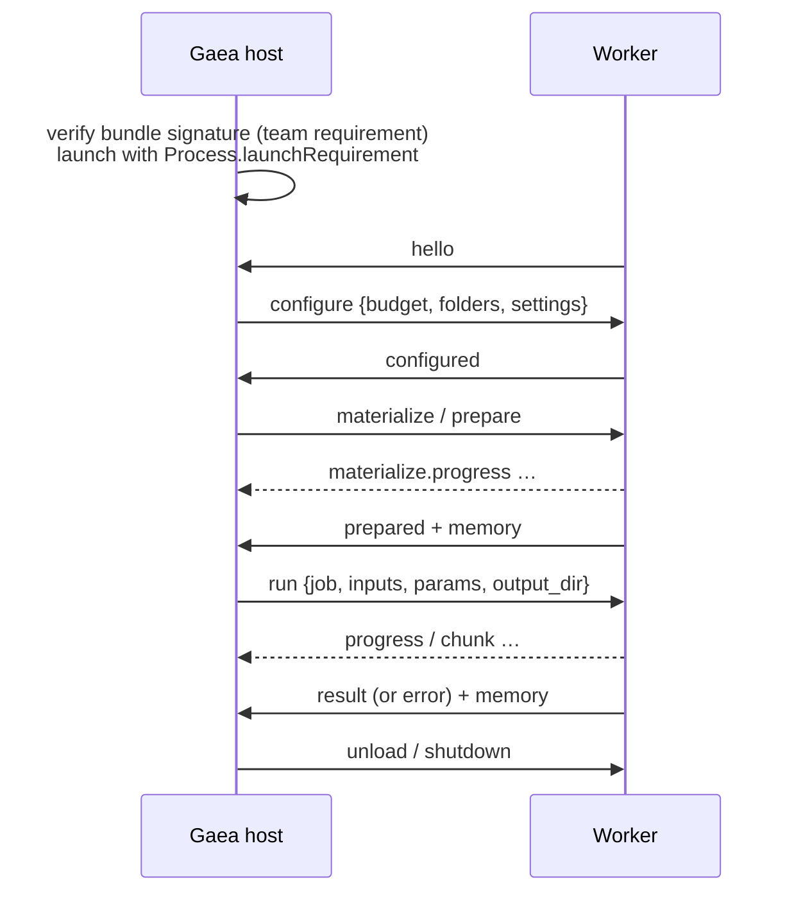

# Gaea Plugin Protocol, version 1

| | |
|---|---|
| **Status** | Draft 1.0, 2026-10-28 (AB-T-0353) |
| **Schemas** | [`schemas/v1/gpp.schema.json`](../schemas/v1/gpp.schema.json) (one line), [`schemas/v1/manifest.schema.json`](../schemas/v1/manifest.schema.json) (manifest.json) |
| **Builds on** | mlx-engine-swift ≥ 0.72.0 (contract 1.57.0, AB-A-0206); MES Base 0.1 and MESKit 0.5.0 (vendored in [`schemas/vendor/mes-v0`](../schemas/vendor/mes-v0)) |
| **Plan** | [Gaea - Plan.md](../Docs/Gaea%20-%20Plan.md) §3; decisions G-2 to G-5 and G-18 (AB-D-0164 to AB-D-0167, AB-D-0180) |

GPP is how the Gaea host talks to a plugin's worker process. The worker is a signed executable in a `.gaeaplugin`
bundle (G-2). It links GaeaPluginKit and MLXEngine; the host links neither MLX nor any model. The manifest tells the
host everything it needs before launching anything; the protocol carries jobs once the worker runs.

## 1. Transport

- **Lines over stdio.** The host writes to the worker's stdin; the worker writes to its stdout. Both pipes are
  private to the parent and child. Every line is one JSON object in UTF-8, at most 1 MiB, ended by `\n`.
- **Logs go to stderr.** Gaea keeps them in the plugin's log. Nothing else may be written to stdout.
- **Media never travels in JSON.** Inputs and outputs are absolute paths. The host only sends paths inside the job's
  spool folder or the plugin's `cache_root`, and only accepts output paths under the run's `output_dir`. Small
  structured outputs (a caption, a checksum) are a result's `value`.
- **Requests and replies.** A request carries an `id`, unique per sender for the life of the connection. Every reply
  carries that id back as `re`. Both sides send requests: the host for work, the worker for its store (§3.6).
- **Unknown lines.** A line that isn't valid JSON, or whose `type` is unknown, is answered with an `error` of code
  `protocol` and no `re`, and otherwise ignored. A known type with invalid fields is answered with `invalid_request`.

## 2. Lifecycle



1. **Launch.** The host checks the bundle's signature against its trust list (G-7), then starts the executable named
   in the manifest with `Process.launchRequirement` pinned to the same team. The working directory is the plugin's
   `cache_root`.
2. **Hello.** The worker's first line is `hello`. The host fails the launch if:
   - no hello arrives within **10 s**;
   - the process exits first (a refused `launchRequirement` is a SIGKILL, so the host watches `terminationHandler`
     rather than waiting out the timeout);
   - `plugin`, `models` or `engine` differ from the verified manifest, or `manifest_sha256` isn't the digest of the
     bundle's `manifest.json`.
3. **Configure.** The host sends `configure` once, before any other request: the memory budget (`WorkerBudget`, which
   the kit passes to `MLXServeEngine(workerBudget:)`), `models_root` (the shared store, G-9), `cache_root`, and the
   operator's settings. It sends `configure` again only for settings whose `apply` is `live`.
4. **Work.** `materialize`, `prepare`, `run`, `unload` and `memory.query` in any order the host's scheduler chooses.
   **One run at a time per worker**, and one GPU job at a time across Gaea in v1 (G-13): the host never sends a second
   `run` before the first has ended. A worker that gets one anyway answers `busy`.
5. **Stop.** `shutdown`, or the escalation ladder (§5).

## 3. Messages

The schema is normative; this section says what each message means. H→W is host to worker; W→H is worker to host.

### 3.1 Start

| Message | Dir | Fields | Meaning |
|---|---|---|---|
| `hello` | W→H | `protocol` (1), `plugin {id, version}`, `pid`, `models[]`, `manifest_sha256`, `kit {version}`, `engine {version, contract}` | The worker is up. `models` lists `models[].id` from the manifest, in order. |
| `configure` | H→W | `id`, `budget`, `models_root`, `cache_root`, `settings {key: value}` | Build the engine with this budget and these folders. |
| `configured` | W→H | `re` | Applied. |

### 3.2 Weights and memory

| Message | Dir | Fields | Meaning |
|---|---|---|---|
| `materialize` | H→W | `id`, `model`, `lane` | Download the lane's weights without loading them (`MLXServeEngine.materialize(package:)`). Only for lanes whose `resolved.materialization` is `engine`; for `package`, the host sends `prepare` instead. |
| `materialize.progress` | W→H | `re`, `model`, `lane`, `fraction`, `bytes_done`, `bytes_total` | Byte-weighted across every source. Also sent during a `prepare` that has to download first. |
| `materialize.done` | W→H | `re`, `model`, `lane`, `bytes`, `seconds` | Every source is on disk. |
| `prepare` | H→W | `id`, `model`, `lane` | Load the lane to resident, downloading first if needed. |
| `prepared` | W→H | `re`, `model`, `lane`, `seconds` | Resident. |
| `unload` | H→W | `id`, `model`, `lane`? | Drop the model (every lane, without `lane`). |
| `unloaded` | W→H | `re`, `model` | Gone. |
| `memory.query` | H→W | `id` | Report now. |
| `memory` | W→H | `re`?, `report` | The engine's `WorkerMemoryReport`, unchanged. Sent with `re` in answer to `memory.query`, and **unprompted after every `prepared`, `unloaded` and `result`**, and after a run's `error` once the run had reached the model (not after a refusal such as `busy`, `unsupported_operation` or `not_materialized`, and not after `shutdown`). |

A model that isn't an MLXEngine package (the plugin's own code, like the demo's matmul) can't be resident in the
engine, so GaeaPluginKit charges its lane's declared footprint to the engine's governor as an external tenant while
it is prepared. The report then shows it only in `availableBytes`: `residents` and `transientReserveBytes` count
engine packages alone.

The host compares `report.physFootprintBytes` with its own `proc_pid_rusage` reading of the worker, and the declared
charge (`residentBytes + transientReserveBytes`) with the lane's manifest figures. A worker whose measured footprint
runs well past its declaration is a manifest bug, logged against the plugin version.

### 3.3 Jobs

| Message | Dir | Fields | Meaning |
|---|---|---|---|
| `run` | H→W | `id`, `job`, `operation`, `model`, `lane`, `inputs {name: path or [paths]}`, `params`, `model_params`?, `adapters[]`?, `seed`?, `output_dir` | One job. |
| `progress` | W→H | `re`, `job`, `stage`, `step`?, `of`?, `fraction`?, `message`? | `stage` is the worker's own phase (`encode_prompt`, `denoise`, `decode`). Gaea reports MES stage `running` with this detail. |
| `chunk` | W→H | `re`, `job`, `output`, `index`, `path`, `media_type`, `final`? | One piece of a streamed output (MES RFC 0002), already written. `result` still follows. |
| `result` | W→H | `re`, `job`, `outputs[]`, `effective`, `warnings[]`, `seconds` | Success. Each output has `path` and `media_type`, or a `value`. |
| `cancel` | H→W | `id`, `job` | Stop cooperatively. The run ends with `error` code `cancelled`, or with its `result` if it finished first. Nothing answers `cancel` itself. |

`inputs` are paths even for text and data: Gaea writes a text input (an MES `prompt`, an `instruction`) to a UTF-8
`.txt` file and a data input (`points`) to a `.json` file in the job's spool, one file per value, and sends a list
when an input has several values. `params` arrive with the offer's `defaults` under what the request sent.

What the host has already done before `run` (plan §3.3): validated the MES request against the profile, chosen this
model and lane, admitted it to memory, and normalized `params` to the profile vocabulary. `model_params` (only `x-`
extension keys) and `adapters` reach the worker exactly as the client sent them (G-3). The worker owns the
model-specific mapping (size grid, steps, masks, tiling) and reports what it actually used in `effective`, which
Gaea merges into the MES result along with provenance and licences.

### 3.4 Stop

| Message | Dir | Fields | Meaning |
|---|---|---|---|
| `shutdown` | H→W | `id` | End any run with `cancelled`, flush, exit 0. Nothing answers. That `cancelled` error is the only line a worker may send after `shutdown`. |

### 3.5 Errors

`error` goes either way: `re` (the failed request), `job` (for a run), `code`, `message`, `retryable`, `detail`?.
Without `re` it is a protocol error about a line that couldn't be attributed.

| Code | Meaning |
|---|---|
| `cancelled` | The run was cancelled or the worker is shutting down. |
| `invalid_request` | The message was well formed but its fields don't make sense to this worker. |
| `unsupported_operation` | The model doesn't do that operation. |
| `unknown_model` | No such model or lane. A host that reads the manifest never causes this. |
| `not_materialized` | A run on a lane whose weights are missing (deleted behind Gaea's back). Retryable after `prepare`. |
| `materialize_failed` | A download failed. `detail` names the repo, revision and URL (MLXEngine's `MaterializeError.source`). |
| `out_of_memory` | The engine refused the load or run within its budget. |
| `model_error` | The model failed. |
| `storage_failed` | A storage request failed (host to worker). |
| `busy` | A second run arrived during the first. |
| `protocol` | An unparseable or unknown line. |
| `internal` | Anything else. |

### 3.6 The plugin's store

A plugin keeps its own data (presets, caches of small derived facts) in a namespaced, versioned store inside
`gaea.sqlite` and never opens the database itself (G-5, G-16). The plugin id is implied by the connection.

| Message | Dir | Fields | Answer |
|---|---|---|---|
| `storage.get` | W→H | `id`, `namespace`, `key` | `storage.result {re, found, value?}` |
| `storage.put` | W→H | `id`, `namespace`, `key`, `value` (any JSON, ≤ 1 MiB) | `storage.result {re}` |
| `storage.delete` | W→H | `id`, `namespace`, `key` | `storage.result {re}` |
| `storage.query` | W→H | `id`, `namespace`, `prefix`?, `after`?, `limit`? (≤ 1000) | `storage.result {re, items[{key, value}], more}`, in key order |

A failure answers `error` with code `storage_failed`. The store's schema version and migrations are declared in the
manifest (§4.6); Gaea runs a plugin's migrations before it launches the new version.

## 4. manifest.json

`Contents/Resources/manifest.json`, sealed by the bundle's signature. **It is generated at build time** from the
plugin's code, so it can't drift from it: GaeaPluginKit's build step encodes `models[]` with MLXToolKit's own
`PackageManifest` and `ResolvedLane` (this repo's `tools/manifest-gen` does the same for the examples), and the plugin
declares the rest in code. Gaea keys are snake_case, like MES; objects the engine owns keep the engine's camelCase.

### 4.1 Identity

`manifest_version` (1), `id` (reverse-DNS; also the bundle id), `version` (semver), `protocol` (1), `min_gaea`,
`team` (the signing Team ID; it must match the signature), `repo` (the GitHub repo the plugin was added from, G-18),
`title`, `summary`, `license` (SPDX of the plugin's own code), `executable` (its file in `Contents/MacOS`), and
`engine {package, version, contract}` when the worker links MLXEngine.

### 4.2 models[]

One entry per MLXEngine package: `id`, `title`, `package` (the `PackageManifest`, unchanged), and `lanes[]`. A lane is
one configuration the plugin can run the package in, usually one per quant: `id`, `default`, and `resolved` (the
engine's `ResolvedLane`). The host schedules from `resolved` alone: `persistentBytes` and `peakTransientBytes` (and
where each came from), `activationScaling`, the weight sources, who materializes them, and which capabilities the
lane backs at its quant. Exactly one lane per model is the default; an operator setting may pick another.

### 4.3 offers[]

What Gaea advertises to MES clients. Each offer is one model for one operation:

- `operation`, `profile`, and `model` (a MES `ModelOffer`: licence, tiers, memory and speed class, adapters, notes);
- `lanes` that may serve it (default: all);
- `params`: the model's own options as `x-` extension parameters, rendered by MESFormsUI. Plugins ship no UI code;
- `defaults` for profile-vocabulary params, and `limits` (pixels, sides, size multiple, images, seconds, frames,
  sample rates);
- `adapters_meta`: host-side facts per adapter (trigger, prompt template, status, clearance per base model, size,
  weight source).

A plugin may offer nothing (G-10's LLM plugin serves only helpers). The manifest declares no remote providers (G-12):
MES allows a `remote_provider` on an offer, so this is Gaea's policy, which the host enforces at install.

### 4.4 helpers[]

Operations Gaea itself calls and never offers to clients, named `x-<vendor>.<name>`: the prompt rewrite before a
generate, a smoke test. Each names its model and declares its params.

### 4.5 settings[]

Operator settings, rendered as forms in Gaea's console (G-17) and sent in `configure`. They replace environment
variables. Each has a `key`, `title`, `schema` (a MES parameter property with a `default`) and `apply`: `live`,
`reload_models` (unload and prepare the affected models) or `restart_worker`.

### 4.6 storage

`schema_version` and the ordered `migrations` ids of the plugin's store.

### 4.7 Rules beyond the schema

`tools/validate.py` checks these too:

- model ids and lane ids are unique, each model has exactly one default lane, and a lane that resolves a quant is
  named after it;
- every lane was resolved under the manifest's `engine.contract`;
- every offer names a model and lanes that exist, sits in its own profile, appears once per operation and model, and
  has at least one lane whose `resolved.capabilities` backs the operation;
- `adapters_meta` describes only adapters the offer lists, and declared params cover their `required` list;
- helpers name existing models; settings keys are unique and every default is valid;
- a plugin offers something or helps with something.

## 5. Escalation

When the host needs memory back, it climbs one rung at a time, moving on when a rung's wait runs out:

| Rung | Wait | Then |
|---|---|---|
| `unload` | 10 s for `unloaded` | `shutdown` |
| `shutdown` | 5 s for exit | SIGTERM |
| SIGTERM | 5 s for exit | SIGKILL |

A kill fails the running job and requeues it once. Client media is never lost: the client holds its inputs (ENG-10).
The spike measured SIGKILL returning 5.12 GB in 65 ms.

## 6. Versions

- **Additive changes** (a new optional field, a new message the other side may ignore, a new error code) keep
  protocol 1. Receivers ignore fields they don't know only where the schema allows it; the v1 schemas are closed, so
  a v1 host validating a newer worker's line sees the new field. Such changes therefore ship in the host first.
- **Anything else** is protocol 2. A host supports a range of protocols; the manifest's `protocol` and `min_gaea`
  decide whether Gaea offers a release at all.
- **The engine-owned objects** follow mlx-engine-swift's contract. `PackageManifest` is checked only at its top level
  and decoded with MLXToolKit; `ResolvedLane` is pinned field by field because the scheduler reads it.

## 7. Checking

```bash
python3 tools/validate.py
```

```bash
python3 tools/test_validator.py
```

```bash
python3 tools/make_examples.py
```

- **`validate.py`** checks every schema's references, the example manifests, and the transcripts in
  `examples/v1/gpp`. A transcript is the lines of a session, each prefixed `H ` or `W `, with a `# manifest:` header
  naming the manifest it runs against. `--manifest <file>` checks one manifest (a plugin build runs it before
  signing); `--transcript <file>` checks one transcript.
- **`test_validator.py`** runs the negative cases: every fixture in `examples/v1/invalid` must fail with the error its
  `# expect:` line names, and each listed mutation of a valid manifest must be rejected.
- **Replays.** GaeaPluginKit's tests replay every transcript here: they send its `H` lines to the kit's worker
  (over a fake package) and compare each `W` line field by field, masking only `pid`, `seconds`, `date`, `kit` (the
  transcripts are kit-agnostic), the measured memory fields and computed output values. A comment `# stdin (not JSON): <text>` makes a replay send `<text>` as a
  raw line, so a transcript can show the answer to a line that isn't JSON.
- **`make_examples.py`** regenerates the example manifests (`models[]` from `tools/manifest-gen`, built on
  mlx-engine-swift) and refreshes the transcripts' manifest digests.

The JSON Schema core in `validate.py` is media-engine-spec's, unchanged, so Gaea and MES reject the same things. The
vendored MES schemas come from MESKit v0.5.0 (7f25bbb).
